<picture>
  <source media="(prefers-color-scheme: dark)" srcset="assets/banner-dark.svg">
  <source media="(prefers-color-scheme: light)" srcset="assets/banner-light.svg">
  
</picture>

# Santiago Alejandro Ochoa Quesada

**Electronics & AI Systems Engineer** · Universidad Nacional de Colombia (`UNAL`) · Bogotá, Colombia  
High-Voltage Instrumentation · Mixed-Signal & Embedded Systems · Edge DSP · Predictive Analytics

---

## Core Architecture & Technical Stack

| Domain | Stack, Methodologies & Standards |
| :--- | :--- |
| **Signal Processing & Applied AI** | `Python` · `NumPy` · `SciPy` · `PyTorch` · `Scikit-Learn` · Least-Squares Harmonic Fitting · Zero-Phase Digital Filtering (`Savitzky-Golay`, `Butterworth`) · Predictive Degradation Modeling (`IEC 60099-5`) |
| **Mixed-Signal Hardware & Embedded** | `KiCad` · `EasyEDA Pro` · Zero-Drift Transimpedance Analog Front-Ends (`OPA2388`/`OPA4388`) · Active Sallen-Key Filtering · `ESP32-S3` / `ESP32-C3` (`BLE`, `Wi-Fi`, `LoRa`) · `Verilog HDL` (`Zybo Z7-10 FPGA`) |
| **Mobile, Desktop & Full-Stack Systems** | `Flutter` / `Dart` (Offline-First Architecture, Real-Time Oscillography, On-Device Voice/AI Copilot) · `PyQt5` / `PyQt6` · `Next.js` · `TypeScript` · `Angular` · `Node.js` |
| **Cloud, Data & Verification** | `Supabase` / `PostgreSQL` · `SQLite` · `Docker` · `AWS` (`EC2`, `S3`, `IAM`) · `Pytest` · `Flutter Test` · `GitHub Actions CI/CD` |

---

## Selected Engineering Systems

### High-Voltage Surge Arrester Diagnostic Ecosystem *(Proprietary Industrial Architecture)*

End-to-end instrumentation, hardware, edge firmware, mobile acquisition, and cloud analytics platform for non-invasive condition monitoring of Metal-Oxide Surge Arresters (`MOSA`) in live substations. *(Source repositories remain private; technical architecture summarized below.)*

* **Mixed-Signal Analog Front-End & Embedded Telemetry:** Engineered a zero-drift transimpedance preamplifier stage (`OPA2388`/`OPA4388`) with an ultra-low-noise regulated negative supply (`LM27761`), solid-state autorange switching (`TS5A3159`), 4th-order Butterworth anti-aliasing filter, frequency-domain stability simulation in Python, and deterministic `ESP32-S3` `BLE` acquisition firmware.
* **Offline-First Field Mobile Client:** Developed a `Flutter` / `Dart` application implementing a real-time DSP pipeline (median despiking, adaptive Savitzky-Golay, zero-phase 4th-order Butterworth filtering, harmonic magnitude extraction), resilient `Supabase` synchronization, and an offline domain-bounded AI & neural voice copilot.
* **Desktop Metrology & Predictive Analytics Suite:** Architected automated sensor calibration workflows, spectral decomposition suites, machine learning health indexing pipelines, and automated verification (`Pytest`, `Docker`, `GitHub Actions`).

---

## Public Repositories

| System | Scope & Architecture | Core Stack |
| :--- | :--- | :--- |
| **[Circadian Dosimetry Wearable (`light-well`)](https://github.com/Sochoaq/light-well)** | Embedded wearable for spectral light dosimetry using multispectral and ambient lux sensors with `Wi-Fi`/`I2C` telemetry. | `C++` · `ESP32-C3` · `AS7262` · `BH1750` |
| **[Long-Range RF Telemetry (`Proyecto-Antenas`)](https://github.com/Sochoaq/Proyecto-Antenas)** | Field environmental telemetry link utilizing `LoRa` transceivers, directional `Yagi-Uda` antennas, and `ESP32` nodes. | `ESP32` · `LoRa` · `RF Design` · `C++` |
| **[Competitive Logistics Engine (`Database-System`)](https://github.com/Sochoaq/Database-System)** | Operational data management desktop platform for multi-stage cycling logistics (*Vuelta a Colombia*) with transactional schemas. | `Python` · `PyQt5` · `SQLite` · `SQL` |
| **[Project Management Platform (`project-manager`)](https://github.com/Sochoaq/project-manager)** | Full-stack planning and milestone tracking web platform structured with separate REST API and SPA layers. | `Angular` · `Node.js` · `Express` |
| **[Autonomous Sumo Robotics (`Robotsumo`)](https://github.com/Sochoaq/Robotsumo)** | Hardware state-machine controller synthesized in Verilog HDL on a `Zybo Z7-10` FPGA interfacing ultrasonic, IR, and 12 V power stages. | `Verilog HDL` · `FPGA` · `Zybo Z7-10` |
| **Verilog HDL IP Cores** | Modular hardware drivers: [`HC-SR04-ultrasonido`](https://github.com/Sochoaq/HC-SR04-ultrasonido) · [`LCD-16x2`](https://github.com/Sochoaq/LCD-16x2) · [`Sumador`](https://github.com/Sochoaq/Sumador) | `Verilog HDL` · `Digital Logic` |

---

## Technical Telemetry

<picture>
  <source media="(prefers-color-scheme: dark)" srcset="assets/radar-skills-dark.svg">
  <source media="(prefers-color-scheme: light)" srcset="assets/radar-skills-light.svg">
  
</picture>
&nbsp;&nbsp;
<picture>
  <source media="(prefers-color-scheme: dark)" srcset="assets/radar-langs-dark.svg">
  <source media="(prefers-color-scheme: light)" srcset="assets/radar-langs-light.svg">
  
</picture>

---

## Contact

* **LinkedIn:** [linkedin.com/in/santiago-alejandro-ochoa-quesada-a07a18288](https://www.linkedin.com/in/santiago-alejandro-ochoa-quesada-a07a18288)
* **Academic Email:** [sochoaq@unal.edu.co](mailto:sochoaq@unal.edu.co)
* **Direct Email:** [santy.alejo4@gmail.com](mailto:santy.alejo4@gmail.com)
