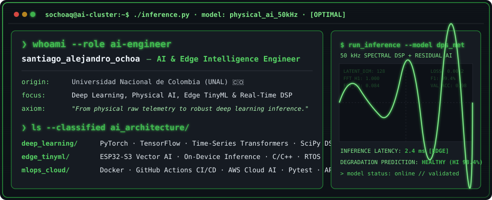

<!-- ANIMATED PARTICLE PORTRAIT BANNER -->
<a href="https://github.com/Sochoaq">
  <picture>
    <source media="(prefers-color-scheme: dark)" srcset="assets/banner-dark.svg">
    <source media="(prefers-color-scheme: light)" srcset="assets/banner-light.svg">
    
  </picture>
</a>

 

<!-- DYNAMIC TYPING BANNER -->

---

## `$ ./whoami.sh`

  

---

## `$ cat tech-stack.yaml`

<table border="1" cellpadding="14" bgcolor="#161b22" style="border: 1px solid #1f6feb; border-collapse: collapse; width: 100%; max-width: 960px;">
  <thead>
    <tr>
      <th colspan="2" align="left" bgcolor="#0d1117" style="border-bottom: 1px solid #1f6feb; color: #58a6ff;">
        <code>sochoaq:~$ cat tech-stack.yaml</code>
      </th>
    </tr>
  </thead>
  <tbody>
    <tr>
      <td width="50%" valign="top" style="border: 1px solid #21262d;">
        <code style="color: #79c0ff;">├─ 📋 ai_project_lifecycle_management:</code>  
        
         
        <code>AI Project Lifecycle · System Requirements &amp; Architecture · Technical Delivery · QA</code>
      </td>
      <td width="50%" valign="top" style="border: 1px solid #21262d;">
        <code style="color: #79c0ff;">├─ 🧠 deep_learning_ai_models:</code>  
        
         
        <code>PyTorch · Deep Learning Architectures · Predictive Modeling · Time-Series AI · SciPy</code>
      </td>
    </tr>
    <tr>
      <td valign="top" style="border: 1px solid #21262d;">
        <code style="color: #79c0ff;">├─ ☁ mlops_cloud_deployment:</code>  
         
        <code>AWS Cloud AI (EC2, S3, IAM, Lambda) · Docker Containerization · CI/CD Pipelines · Linux</code>
      </td>
      <td valign="top" style="border: 1px solid #21262d;">
        <code style="color: #79c0ff;">├─ ✦ data_pipelines_testing:</code>  
        
        
         
        <code>Vectorized Data Pipelines · NumPy · Pandas · Pytest Validation Suites · SQL Schemas</code>
      </td>
    </tr>
    <tr>
      <td colspan="2" valign="top" style="border: 1px solid #21262d;">
        <code style="color: #79c0ff;">╰─ ⌁ systems_integration_edge:</code>  
        
         
        <code>Edge Systems &amp; TinyML · ESP32 · C/C++ · Desktop Instrumentation (PyQt6) · Systems Integration</code>
      </td>
    </tr>
  </tbody>
  <tfoot>
    <tr>
      <td colspan="2" bgcolor="#0d1117" style="border-top: 1px solid #1f6feb; color: #a5d6ff;">
        <code>status: projects_delivered&nbsp;&nbsp;·&nbsp;&nbsp;methodology: agile_ai_lifecycle&nbsp;&nbsp;·&nbsp;&nbsp;env: production</code>
      </td>
    </tr>
  </tfoot>
</table>

---

## `$ telemetry-signals --radar`

  <picture>
    <source media="(prefers-color-scheme: dark)" srcset="assets/radar-skills-dark.svg">
    <source media="(prefers-color-scheme: light)" srcset="assets/radar-skills-light.svg">
    
  </picture>&nbsp;&nbsp;&nbsp;
  <picture>
    <source media="(prefers-color-scheme: dark)" srcset="assets/radar-langs-dark.svg">
    <source media="(prefers-color-scheme: light)" srcset="assets/radar-langs-light.svg">
    
  </picture>

<code>telemetry: ai_project_delivery_radar · github_code_mix_radar · status: healthy</code>

---

## `$ ./deploy --projects`

### ⚡ [Industrial Diagnostics &amp; Predictive Analytics Suite](https://github.com/Sochoaq/DPS)
> **Solución integral de diagnóstico y analítica predictiva para instrumentación y telemetría industrial.**
* **Ingeniería del Proyecto:** Dirección y diseño integral de la arquitectura del sistema, desde la adquisición de datos de alta frecuencia hasta el procesamiento analítico.
* **Modelado Analítico:** Implementación de algoritmos de descomposición armónica (FFT) y modelos de degradación de salud operativa basados en estándares técnicos.
* **MLOps y Calidad:** Arquitectura contenerizada con **Docker**, suites de pruebas automatizadas con **Pytest** y despliegue continuo mediante **GitHub Actions CI/CD**.
* **Stack:** `Python 3.11` · `PyQt6` · `NumPy` · `SciPy` · `Docker` · `GitHub Actions` · `Pytest`

---

### 📊 [High-Throughput Logistics &amp; Data Management Engine](https://github.com/Sochoaq/Database-System)
> **Motor de gestión de datos y telemetría logística para eventos de alto impacto.**
* Diseñado para la centralización, trazabilidad y coordinación operativa en competencias de ruta multipunto (Vuelta a Colombia).
* Implementación de esquemas relacionales robustos en SQLite, operaciones transaccionales y diseño de interfaces optimizadas para operadores.
* **Stack:** `Python` · `PyQt5` · `SQLite` · `SQL`

---

### 💡 [Circadian Dosimetry &amp; Multispectral Wearable](https://github.com/Sochoaq/light-well)
> **Sistema embebido e IoT para análisis y dosimetría de luz multiespectral.**
* Integración de microcontroladores ESP32-C3 y sensores ópticos multiespectrales con transmisión de telemetría vía Wi-Fi/I2C.
* Procesamiento y categorización de distribuciones espectrales para aplicaciones de bienestar y cronobiología.
* **Stack:** `C++` · `ESP32-C3` · `Wi-Fi` · `I2C` · `Embedded C`

---

## `$ connect --channels`

&nbsp;&nbsp;
&nbsp;&nbsp;
&nbsp;&nbsp;

 

<code>[SYSTEM] Node active · Engineered with precision from Colombia · @Sochoaq</code>

