<picture>
  <source media="(prefers-color-scheme: dark)" srcset="assets/banner-dark.svg">
  <source media="(prefers-color-scheme: light)" srcset="assets/banner-light.svg">
  
</picture>

# Santiago Alejandro Ochoa Quesada

**AI Systems & MLOps Engineer · Electronics & Computer Systems** · Universidad Nacional de Colombia (`UNAL`) · Bogotá, Colombia  
Multi-Agent LLM Orchestration · Deep Learning & Time-Series ML · Production MLOps · Domain-Guarded Edge AI

---

## Core Architecture & Technical Stack

| Domain | Stack, Methodologies & Standards |
| :--- | :--- |
| **Multi-Agent AI & LLM Orchestration** | `Python` · `Google GenAI / Gemini SDK` · `Anthropic Claude SDK` · `Pydantic` Structured Outputs · Drafter-Reviewer Agent Pipelines · Prompt-Injection Sanitization Guards · Local `RAG` & Tool-Calling Voice Copilots |
| **Machine Learning, Deep Learning & Signal AI** | `PyTorch` · `Scikit-Learn` · `NumPy` · `SciPy` · Time-Series Degradation Modeling · Spectral Feature Extraction (`FFT` / Least-Squares Harmonic Fitting) · Zero-Phase Digital Filtering (`Savitzky-Golay`, `Butterworth`) |
| **MLOps, Cloud & Production Verification** | `Docker` · `GitHub Actions CI/CD` · `AWS` (`EC2`, `S3`, `IAM`, `Lambda`) · `Supabase` / `PostgreSQL` · `SQLite` · `Pytest` · Automated Layout & Security Gates |
| **Edge AI, Mobile & Mixed-Signal Hardware** | `Flutter` / `Dart` (Offline-First Architecture, On-Device Neural Voice/NLU Copilot) · `ESP32-S3` / `ESP32-C3` (`BLE`, `Wi-Fi`, `LoRa`) · `C/C++` · `Verilog HDL` (`Zybo Z7-10 FPGA`) · Zero-Drift Analog Front-Ends (`OPA2388`/`OPA4388`) |

---

## Selected AI & Production Systems

### [Aegis Agent Mesh — Multi-Agent Incident Triage & LLMOps Guardrail Engine (`aegis-agent-mesh`)](https://github.com/Sochoaq/aegis-agent-mesh)

End-to-end multi-agent incident response, hybrid retrieval, and deterministic safety governance architecture engineered in `Python`, `Pydantic v2`, `SQLite`, and `Docker`.

* **4-Agent State Graph:** Orchestrates `TelemetryAnomalyAgent` (Z-score spike detection + EWMA drift), `RunbookRAGAgent` (Hybrid **BM25 + TF-IDF Cosine** retriever fused via **Reciprocal Rank Fusion**), `RootCauseArchitectAgent` (Gemini SDK / deterministic structured synthesis), and `PolicyGuardrailAgent`.
* **LLMOps Safety & Prompt-Injection Defense:** Detects indirect prompt injections hidden in untrusted telemetry/log streams (including Unicode Tag characters and RCE/SQL payloads), enforces mandatory `[RB-xxx]` citation grounding, and gates `HIGH`/`CRITICAL` blast-radius tool calls behind operator sign-off.
* **Verified Evaluation Suite & Observability:** Includes a 12-scenario golden + red-team benchmark suite (`100.0%` top-1 runbook recall, citation grounding, and adversarial block rate), HTTP JSON API, SQLite audit ledger, and GitHub Actions CI.

### [Autonomous Multi-Agent LLM Orchestration & Document Synthesis Engine (`ai-job-hunter`)](https://github.com/Sochoaq/ai-job-hunter)

Production-hardened multi-agent framework built on `Python`, **Google GenAI SDK**, and **Claude Code** subagents for semantic role routing, structured evaluation, and automated LaTeX/PDF synthesis.

* **Multi-Agent Pipeline & Structured Reasoning:** Orchestrates specialized evaluator (`FitAnalysis`) and drafter-reviewer agents (`TailoredApplication`) via `Pydantic` schema enforcement, exponential backoff resilience, CEFR language-gate logic, and multi-track semantic classification (`AI_ENGINEERING`, `CLOUD_DEVOPS`, `HARDWARE_EMBEDDED`).
* **Prompt-Injection Defense & Supply-Chain Security:** Enforces deterministic sanitization gates (`posting_guard.py`) against hidden HTML, invisible CSS boxes, Unicode tag characters, and injection payloads on untrusted web postings, paired with AST/allowlist verification (`security_guards.py`).
* **Dual-Engine Compilation & State Analytics:** Synthesizes 2-page `Tectonic`/`LaTeX` + `TikZ` documents with automatic `PyMuPDF` fallback, ATS text-layer verification (`verify_pdf.py`, `verify_layout.py`), and `SQLite` state persistence with self-contained HTML/CSV reporting.

### Industrial Predictive AI, Domain-Guarded Voice Copilot & Edge DSP Platform *(Proprietary Production Ecosystem)*

End-to-end applied AI, edge DSP acquisition, mobile offline-first intelligence, and cloud MLOps ecosystem engineered for real-time industrial telemetry and automated anomaly diagnostics. *(Core industrial repositories remain private; AI & software architecture summarized below.)*

* **Domain-Guarded Conversational & Neural Voice Copilot:** Engineered an offline-capable `Flutter` / `Dart` assistant with deterministic safety guardrails, structured tool-calling, local `RAG` grounded in technical telemetry, and hands-free neural TTS/STT synthesis.
* **Predictive Time-Series ML & MLOps Pipeline:** Built automated multi-variable health-indexing and degradation modeling workflows backed by zero-phase DSP feature extraction (median despiking, adaptive Savitzky-Golay, 4th-order Butterworth, least-squares harmonic decomposition), containerized with `Docker` and verified via `Pytest` and `GitHub Actions CI/CD`.
* **Edge Telemetry & Mixed-Signal Acquisition:** Designed low-noise zero-drift transimpedance hardware and `ESP32-S3` `BLE` streaming firmware feeding synchronized time-series telemetry into `Supabase` / `PostgreSQL`.

---

## Public Repositories

| System | Scope & Architecture | Core Stack |
| :--- | :--- | :--- |
| **[Multi-Agent LLMOps Guardrail Engine (`aegis-agent-mesh`)](https://github.com/Sochoaq/aegis-agent-mesh)** | 4-agent incident triage state graph with Hybrid BM25 + Cosine RRF-RAG, indirect prompt-injection defense, blast-radius governance, SQLite ledger, and 12-scenario evals. | `Python` · `Pydantic v2` · `RRF-RAG` · `SQLite` · `Docker` |
| **[Multi-Agent LLM Orchestrator (`ai-job-hunter`)](https://github.com/Sochoaq/ai-job-hunter)** | Autonomous multi-agent evaluation, prompt-injection sanitization guards, semantic routing, and dual-engine `LaTeX`/`PyMuPDF` synthesis with `SQLite` analytics. | `Python` · `Gemini/Claude SDK` · `Pydantic` · `SQLite` |
| **[Circadian Photometry & ML Platform (`light-well`)](https://github.com/Sochoaq/light-well)** | ESP32-C3 multispectral CIE 1931 / mEDI edge engine, Tuya HMAC-SHA256 actuation, Supabase telemetry, and Python spectral regime classifier (`100%` 5-fold CV). | `Python` · `C++` · `ESP32-C3` · `Supabase` |
| **[Long-Range RF Telemetry (`Proyecto-Antenas`)](https://github.com/Sochoaq/Proyecto-Antenas)** | Field environmental telemetry link utilizing `LoRa` transceivers, directional `Yagi-Uda` antennas, and `ESP32` nodes. | `ESP32` · `LoRa` · `RF Design` · `C++` |
| **[Competitive Logistics Engine (`Database-System`)](https://github.com/Sochoaq/Database-System)** | Operational data management desktop platform for multi-stage cycling logistics (*Vuelta a Colombia*) with transactional schemas. | `Python` · `PyQt5` · `SQLite` · `SQL` |
| **[Project Management Platform (`project-manager`)](https://github.com/Sochoaq/project-manager)** | Full-stack planning and milestone tracking web platform structured with separate REST API and SPA layers. | `Angular` · `Node.js` · `Express` |
| **[Autonomous Sumo Robotics (`Robotsumo`)](https://github.com/Sochoaq/Robotsumo)** | Hardware state-machine controller synthesized in Verilog HDL on a `Zybo Z7-10` FPGA interfacing ultrasonic, IR, and 12 V power stages. | `Verilog HDL` · `FPGA` · `Zybo Z7-10` |
| **Verilog HDL IP Cores** | Modular hardware drivers: [`HC-SR04-ultrasonido`](https://github.com/Sochoaq/HC-SR04-ultrasonido) · [`LCD-16x2`](https://github.com/Sochoaq/LCD-16x2) · [`Sumador`](https://github.com/Sochoaq/Sumador) | `Verilog HDL` · `Digital Logic` |

---

## Technical Telemetry

<picture>
  <source media="(prefers-color-scheme: dark)" srcset="assets/radar-skills-dark.svg">
  <source media="(prefers-color-scheme: light)" srcset="assets/radar-skills-light.svg">
  
</picture>
&nbsp;&nbsp;
<picture>
  <source media="(prefers-color-scheme: dark)" srcset="assets/radar-langs-dark.svg">
  <source media="(prefers-color-scheme: light)" srcset="assets/radar-langs-light.svg">
  
</picture>

---

## Contact

* **LinkedIn:** [linkedin.com/in/santiago-alejandro-ochoa-quesada-a07a18288](https://www.linkedin.com/in/santiago-alejandro-ochoa-quesada-a07a18288)
* **Academic Email:** [sochoaq@unal.edu.co](mailto:sochoaq@unal.edu.co)
* **Direct Email:** [santy.alejo4@gmail.com](mailto:santy.alejo4@gmail.com)
